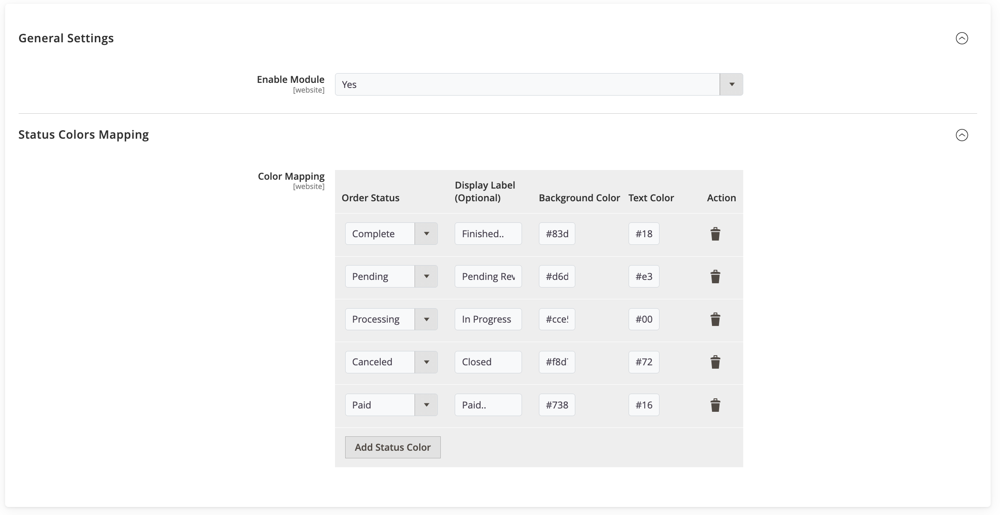
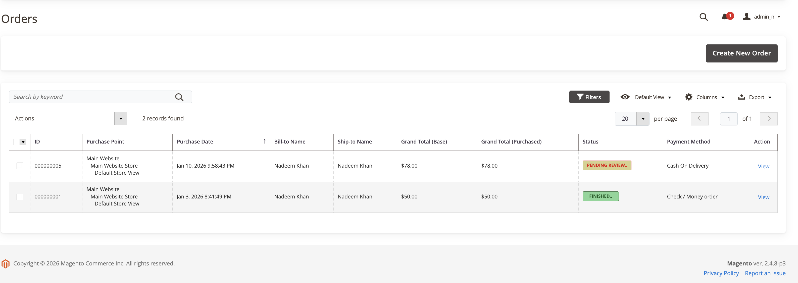
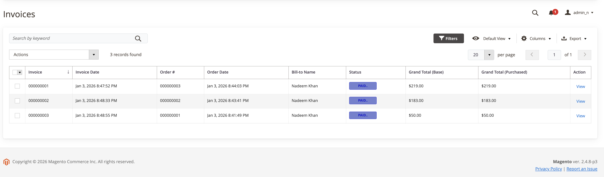
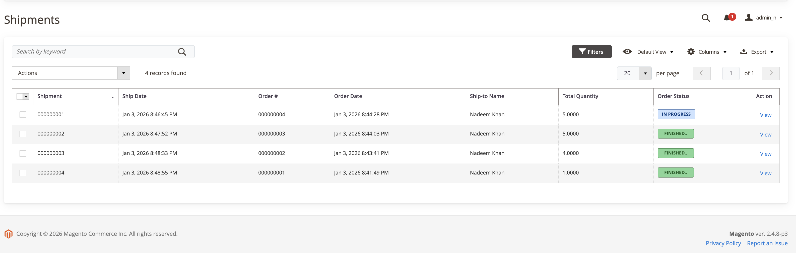

# Magento 2 Extension — OrderStatusColor

     
  
##### DevScripts Order Status Color adds configurable color labels to order statuses in the Magento 2 admin order grid, allowing administrators to quickly identify order states. The module includes backend settings to enable or disable the feature and manage status colors easily.
---

## Installation  

1. Copy the contents of this repository into:  
   ```bash
   {MAGENTO_ROOT}/app/code/DevScripts/OrderStatusColor/
   ```
2. Run the following commands in your Magento root directory:  
   ```bash
   php bin/magento setup:upgrade
   php bin/magento setup:static-content:deploy
   php bin/magento cache:flush
   ```
---

## Screenshots  

**Admin Configuration**  

 

**Sales Order**  

 

**Sales Invoices**  

 

**Sales Shipment**  

 

---

## Prerequisites  

Ensure the following requirements are met before installing this extension:

| Prerequisite | How to Check | Documentation |
|--------------|--------------|---------------|
| Apache / Nginx | `apache2 -v` (Ubuntu)<br><br>`nginx -v` | [Apache Docs](https://devdocs.magento.com/guides/v2.2/install-gde/prereq/apache.html) <br> [Nginx Docs](https://docs.nginx.com/nginx/admin-guide/installing-nginx/installing-nginx-open-source/)|
| PHP >= 8.1 | `php -v` | [PHP on Ubuntu](http://devdocs.magento.com/guides/v2.2/install-gde/prereq/php-ubuntu.html)<br>[PHP on CentOS](http://devdocs.magento.com/guides/v2.2/install-gde/prereq/php-centos.html) |
| MySQL 5.6.x | `mysql -u [root username] -p` | [MySQL Docs](http://devdocs.magento.com/guides/v2.2/install-gde/prereq/mysql.html) |

---

## Contribution  

Contributions are welcome!  
The fastest way to contribute is by submitting a [pull request](https://help.github.com/articles/about-pull-requests/) on GitHub.  

---

## Issues & Support  

If you encounter any issues or bugs, please [open an issue](https://github.com/inadeemkhan/magento2-admin-order-status-in-color/issues) on GitHub.  

For direct support or feedback, feel free to contact:  
📧 [khannadeem243@gmail.com](mailto:khannadeem243@gmail.com)  
